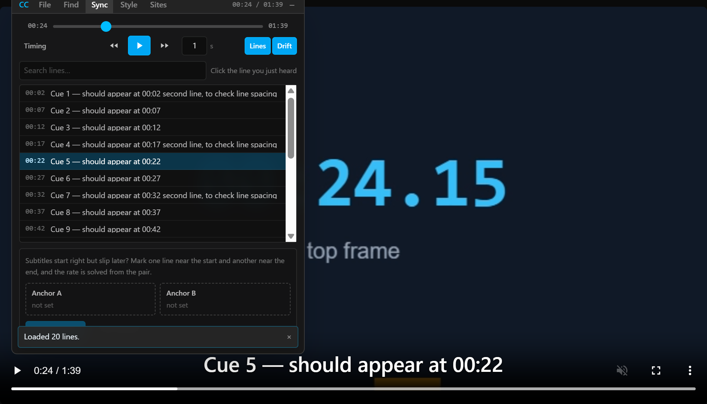
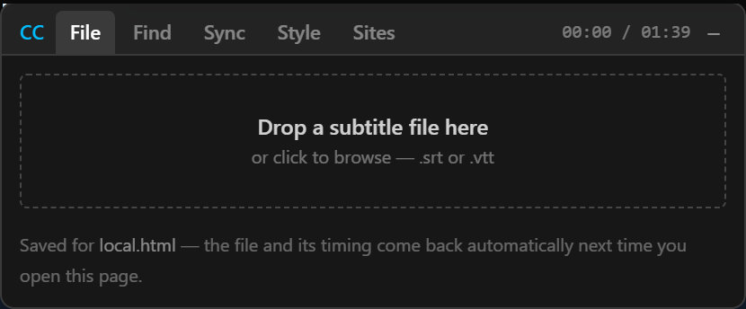
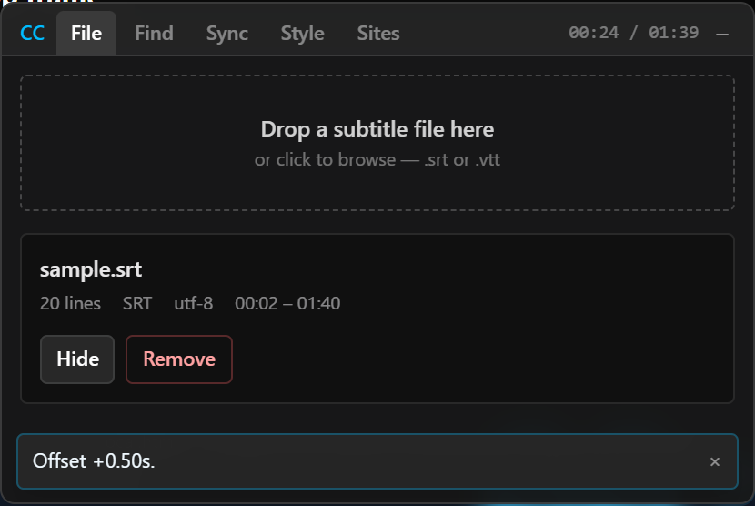
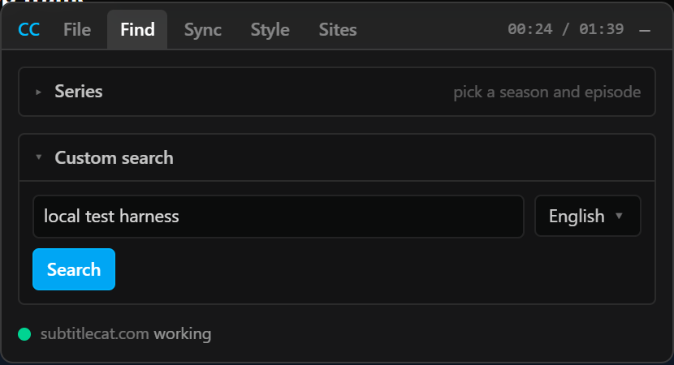
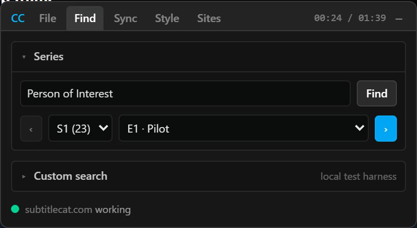
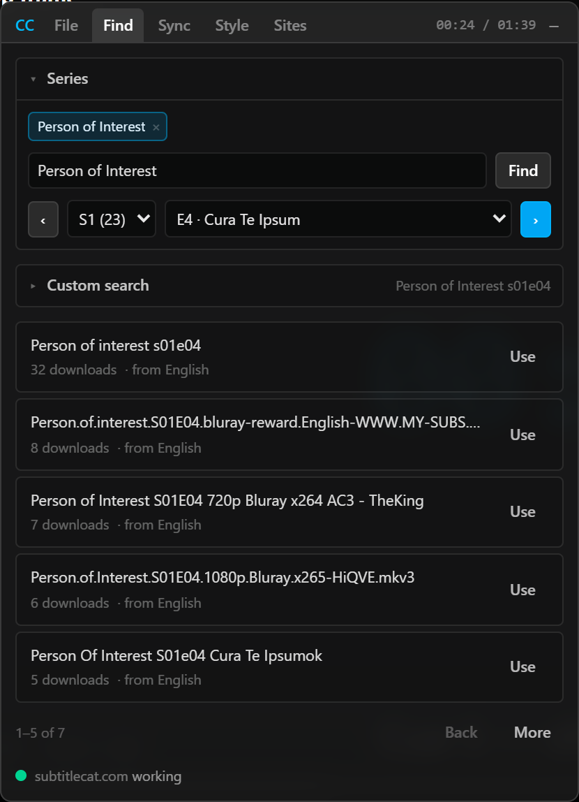
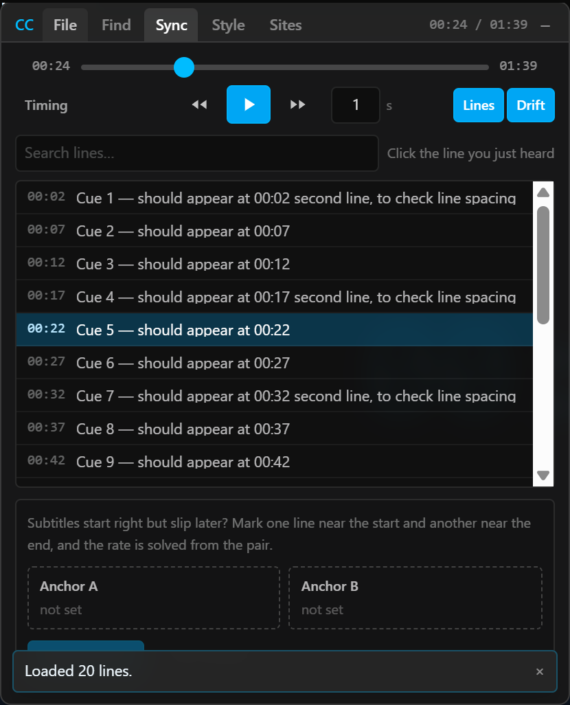
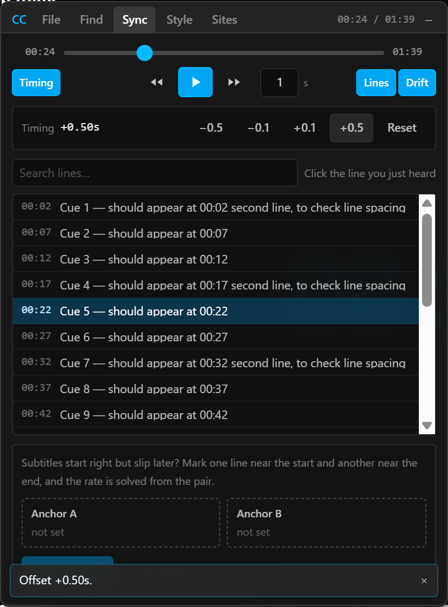
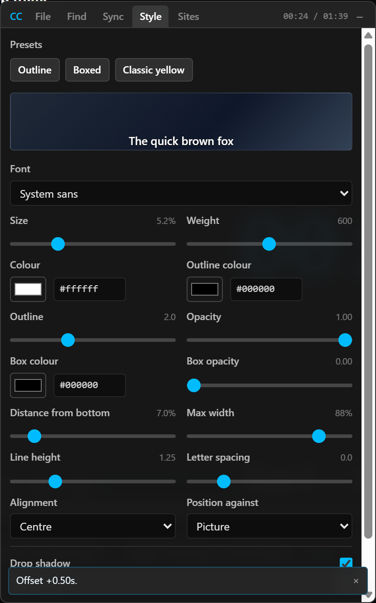
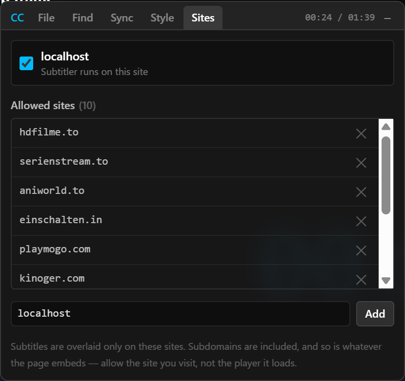

# Subtitler

A browser extension that puts your own subtitles on top of any HTML5 video, with a click-to-sync
tool for fixing mistimed tracks, built-in subtitle search, and a TV-series browser. It works in
Chrome, Edge, Brave and Firefox (128+). It needs **no server and no account**, and it is free.



- [Install from a release](#install-from-a-release-no-build-needed) · [Build it yourself](#build-it-yourself)
- [Export the extension](#export-the-extension) (Chrome, Brave, Firefox, Firefox Nightly on Android)
- [Allowing a site](#allowing-a-site)
- [The panel](#the-panel)
- [File tab](#file-tab) · [Find tab](#find-tab) · [Sync tab](#sync-tab) · [Style tab](#style-tab) · [Sites tab](#sites-tab)
- [Keyboard shortcuts](#keyboard-shortcuts)
- [Tips and troubleshooting](#tips-and-troubleshooting)
- [For developers](#for-developers)

---

## Install from a release (no build needed)

Download the file for your browser from the
[Releases page](https://github.com/escaper01/subtitler_sync/releases):

| File | For |
|---|---|
| `subtitler-chrome-<version>.zip` | Chrome, Edge, Brave |
| `subtitler-firefox-<version>.xpi` | Firefox, Firefox Nightly (desktop and Android) |

**Chrome / Edge / Brave**

1. Unzip the file into a folder you will keep (the browser reads the extension from there, so do
   not delete it).
2. Open `chrome://extensions` (Brave: `brave://extensions`, Edge: `edge://extensions`).
3. Turn on **Developer mode** (top right).
4. Click **Load unpacked** and choose the unzipped folder, the one that contains `manifest.json`.
5. Pin the extension from the puzzle-piece menu if you want its icon on the toolbar.

**Firefox**

Release Firefox only runs add-ons signed by Mozilla, so an unsigned `.xpi` needs one of these:

- **Quick test:** `about:debugging#/runtime/this-firefox` → **Load Temporary Add-on** → pick the
  `.xpi` (or its unzipped `manifest.json`). It is removed when Firefox restarts.
- **Permanent:** use Firefox Developer Edition, Nightly or ESR, open `about:config`, set
  `xpinstall.signatures.required` to `false`, then drag the `.xpi` into the window and confirm.

**Firefox Nightly on Android:** see [the steps below](#firefox-nightly-on-android).

After installing, allow the site you watch: see [Allowing a site](#allowing-a-site).

---

## Build it yourself

Build it once (Node 20+):

```bash
npm install
npm run check
```

| Browser | How to load it |
|---|---|
| **Chrome / Edge / Brave** | Open `chrome://extensions` (Brave: `brave://extensions`), turn on **Developer mode**, click **Load unpacked** and choose `dist`. |
| **Firefox** | Open `about:debugging#/runtime/this-firefox`, click **Load Temporary Add-on** and choose `dist-firefox/manifest.json`. It is removed when Firefox restarts. |

After rebuilding, press the reload icon on the extension's card, then reload the page you were
watching. Publishing notes are in [`CLAUDE.md`](./CLAUDE.md).

## Export the extension

Build first (`npm install && npm run check`). That produces the Chrome
build in `dist/` and the Firefox build in `dist-firefox/`. Neither folder is committed.

### Chrome, Edge and Brave

They share one build, `dist`.

- **Use it yourself:** `chrome://extensions` (Brave: `brave://extensions`) → **Developer mode** →
  **Load unpacked** → pick `dist`.
- **Send it to someone as a file:** `npm run package:chrome` writes
  `release/subtitler-chrome-<version>.zip` with `manifest.json` at the top. They unzip it and use
  **Load unpacked** on the folder.
- **Make a `.crx`:** on the extensions page choose **Pack extension**, set the root to `dist` and,
  to keep the same extension id, the private key to `key.pem`. Chrome and Brave
  only install `.crx` files from outside their store if the user turns developer mode on and drags
  the file in, so the unpacked folder is usually easier.
- **Chrome Web Store:** upload the zip of `dist`. The key in `key.pem` pins the extension id, so
  back it up and never commit it.

### Firefox (desktop)

```bash
npm run package:firefox
```

This builds `dist-firefox/` and writes `release/subtitler-firefox-<version>.xpi`, ready to install
as described below.

- **Temporary (testing):** `about:debugging#/runtime/this-firefox` → **Load Temporary Add-on** →
  pick `dist-firefox/manifest.json`. It disappears when Firefox restarts.
- **Permanent, unsigned (Developer Edition, Nightly or ESR only):** release Firefox refuses
  unsigned add-ons. In a build that allows it, open `about:config`, search for
  `xpinstall.signatures.required`, set it to `false`, then open the `.xpi` (drag it into Firefox, or
  *Install Add-on From File* in the add-ons page).
- **Permanent, signed (everyone else):** submit the zip to
  [Mozilla Add-ons](https://addons.mozilla.org) for signing. Its id is
  `subtitler-isolated@escaper01.github.io`; changing it makes Firefox treat it as a different
  extension.

### Firefox Nightly on Android

Needs Firefox Nightly 142 or newer. Stable Firefox for Android only installs add-ons from Mozilla's
own list, which is why Nightly is used here.

1. Get the `.xpi` from the Releases page, or build it with `npm run package:firefox`.
2. Copy the `.xpi` to the phone (USB, cloud drive, or send it to yourself).
3. Install unsigned add-ons by turning off the signature check: open **`about:config`** in
   Firefox Nightly, search for **`xpinstall.signatures.required`** and set it to **`false`**.
4. Enable the debug menu: **Settings → About Firefox Nightly**, then tap the Firefox logo five
   times. A new **Install extension from file** entry appears in Settings.
5. Tap **Install extension from file** and pick the `.xpi`.
6. Open a video on an allowed site (the toolbar menu lets you allow the current site). Use the
   extension's entry in the add-ons menu to open the popup.

For development you can skip the file and run it straight from your computer: turn on **Remote
debugging via USB** in Nightly's settings, connect the phone, and run
`npx web-ext run --source-dir dist-firefox --target firefox-android --android-device <id>`
(`adb devices` lists the id).

Permanent distribution on Android is the same as desktop: get it signed through Mozilla Add-ons.
The Android build has not been tested on a real phone from this repository, only built and
structurally checked, so try the harness (`test/local.html`) first if something looks off.

---

## Allowing a site

The extension does nothing on a site you have not allowed. Click the toolbar icon to allow the
site you are on. A few streaming sites are allowed out of the box, and `localhost` is always
there for testing. The streaming sites change domain often (`.win`, `.best`, `.to`, …), so when
one moves, just allow its new address. The **Sites** tab does the same thing from inside the
panel. Allowing a site covers its subdomains.

Switching a site on or off takes effect immediately, with no reload.

## The panel

Start playing a video on an allowed site and the panel appears over the player. Only a real film
counts: videos shorter than 90 seconds (ads, previews) are ignored.



The top bar holds everything that used to need two rows:

- **CC** is the drag handle. Drag the bar's empty space to move the panel; it stays inside the
  player. Hover it for the shortcut list.
- **File · Find · Sync · Style · Sites** are the tabs.
- The **clock** shows the video's current time (and the duration when the panel is wide enough).
- **−** collapses the panel to a small **CC** pill in the corner. Click the pill to bring it back.

Messages such as "Loaded 1,204 lines", "Shifted by +0.40s" or an error appear as a small
**toast** at the bottom of the panel and disappear by themselves, so they never push the content
down. The panel works in fullscreen, because it lives inside the player's own frame.

The first time you open a film the panel opens by itself. When you come back to a film whose
subtitles are already loaded and timed, it stays collapsed and the subtitles just show.

---

## File tab

Load a subtitle you already have.

1. Drop a `.srt` or `.vtt` file onto the dashed box, or click it to browse.
2. The subtitles appear on the video and the panel jumps to the **Sync** tab.



Once a track is loaded you see its name, the number of lines, its format, the text encoding that
was detected and the time range it covers. Files in older encodings (for example Windows-1252 or
Windows-1256) are detected automatically. If the file had odd lines that were skipped, a
"parsing warnings" link lists them.

- **Hide / Show** turns the subtitles off and on without losing them.
- **Remove** unloads the track.

The track and its timing are saved **per film**. Next time you open the same page, they come
back by themselves and a toast says "Restored … for this video".

## Find tab

Search for subtitles without leaving the page.



The tab has two collapsible sections: **Series** (for television, see below) and **Custom
search** (type a title yourself, which is how you find a film). The search box in Custom search is
pre-filled with a guess from the page title. It is never searched automatically, so fix the guess
if it is wrong and press **Search** (or Enter).

- **Source status:** a dot at the bottom of the tab shows whether the subtitle site works.
  Green is working, red is not responding, amber is "could not be checked" (for example it asked
  you to slow down). The test runs at most once every 24 hours; hover the dot for the time and
  details.
- **Language:** the dropdown next to the search box picks the subtitle language. Changing it
  re-runs the search.
- **Results** are listed by *release*, which is the name of the video file somebody timed the
  subtitles against, with its download count and the language it was translated from. A subtitle
  made for the same release as your video usually needs no syncing at all, so look at the name
  first. Each page shows five releases; use **Back** and **More** to page through them. A release
  that failed to open gets a **Retry** button.
- **Click Use** on a result to download and load it. It lands on the Sync tab.
- If the site asks you to slow down you will see an amber "rate limited" note instead of a red
  error. Wait a moment and try again.

### Series browser (television)

For a series you can click instead of typing `Person of Interest s01e04` every time. Expand
**Series** at the top of the Find tab.



1. Type the series name and press Enter, then click the right show in the list. Shows you used
   recently are remembered as chips; click one to resume where you left off, **×** forgets it.
2. A single row shows **‹ Season ▾ Episode ▾ ›**. Choosing an episode puts `Show s01e04` into the
   search box and **runs the search** straight away.
3. **‹** and **›** step to the previous or next episode and search for it. They follow the real
   episode list, so the end of a season carries into the next one correctly.



This browser only knows television. For a film, type the title into the search box yourself.

## Sync tab

Fix subtitles that appear too early, too late, or slowly slip out of step.



### Player controls

The top of the tab is a small remote for the video so you do not have to reach for the player:

- A **seek bar** across the full width. Click or drag to jump to any time; the current time is on
  its left and the duration on its right.
- **Back**, **play/pause** and **forward** buttons. The box beside them is the number of seconds
  they skip. It starts at **1** and you can type any value (for example `0.5` or `10`).
- Three toggles on the same row show or hide the sections below. A hidden section takes no space.
  **Lines** and **Drift** are on by default; **Timing** is off.

### Lines

The list of every subtitle line with the time it will appear at. **Click the line you are hearing
right now** and the whole track shifts so that line lands on the current moment. Type in
**Search lines…** to find a particular line. The list follows playback; if you scroll it yourself,
auto-follow pauses for a few seconds. Each row is one line of text; hover a row to read all of it.

### Timing

Turn on **Timing** for fine adjustment. It shows the current offset and buttons for **−0.5 / −0.1 /
+0.1 / +0.5** seconds, plus **Reset** to go back to the file's own timing.



### Drift

Use this when the subtitles start right but get further out of step as the film goes on. That is
almost always a framerate mismatch (for example a 25 fps subtitle against a 23.976 fps video),
and a single shift cannot fix it.

1. Play to a line near the **start**. Click **Anchor A**, then click the line you are hearing.
2. Play to a line near the **end** (at least a minute later). Click **Anchor B** and pick the line
   you are hearing.
3. Press **Apply rate fix**. The speed of the whole track is worked out from the two points.

If the result is almost exactly a known framerate ratio (such as 23.976 → 25), a toast offers a
**Snap to …** button; take it to remove the last bit of error. **Clear anchors** starts over.

## Style tab

Make the subtitles easy to read.



Start with a **preset**, then tune anything: font, size, weight, text and outline colour, outline
width, opacity, a background box with its own colour and opacity, distance from the bottom, maximum
width, line height, letter spacing, alignment, drop shadow and uppercase. A live preview sits at
the top. **Position against** chooses whether the text is placed relative to the picture itself
(so it never floats over a letterbox bar) or to the whole player. Your style is saved and follows
you to every film.

## Sites tab



The top box shows the site you are on, with a checkbox to turn the extension on or off for it. Below
is the list of every allowed site: remove one with **×**, or type a new address in the box at the
bottom and press **Add**. Subdomains are included, and so is whatever the page embeds, so allow the
site you visit, not the player it loads. This is the same list as the toolbar popup.

---

## Keyboard shortcuts

They work while the panel is open and you are not typing in a box.

| Key | Action |
|---|---|
| `Alt+Shift+S` | Show or hide the panel (change it at `chrome://extensions/shortcuts`) |
| `S` | Sync to the line being spoken right now |
| `G` / `H` | Nudge the subtitles 0.1 s earlier / later |
| `Shift+S` | Collapse the panel |

## Tips and troubleshooting

- **No panel at all?** The site is probably not allowed. Click the toolbar icon, and allow it.
  Also make sure the video is longer than 90 seconds and has started playing.
- **Panel disappeared after reloading the extension?** Reload the page under test as well; old
  scripts do not survive an extension reload.
- **Search finds nothing?** Look at the dot at the bottom of the Find tab. Red means the subtitle
  site is not answering or has changed its layout, so it is not your search. Developers: run
  `LIVE=1 npm test` to see which.
- **Spaces do not type into a box?** They do; the panel handles players that grab the space key.
- **Subtitle looks fine but the speech is slightly off?** Click the line you hear (Lines), or nudge
  with Timing. If it gets worse towards the end, use Drift.

## For developers

The architecture, constraints and gotchas are in [`CLAUDE.md`](./CLAUDE.md); the offline test page is `test/local.html`
(run `npm run dev` and open `/test/local.html`); `sample.srt` and `sample-drift.srt` next to it
are the fixtures for syncing and drift.

Privacy: the extension makes requests only to `subtitlecat.com` and `api.tvmaze.com`, always
from its background worker. It sends no account, identifier or
credential to anyone.

## Publishing a release

Bump `version` in `package.json`, run `npm run check`, then build both files and attach them to a
GitHub release:

```bash
npm run package
gh release create v0.1.0 release/subtitler-chrome-0.1.0.zip release/subtitler-firefox-0.1.0.xpi --title "v0.1.0" --notes "What changed"
```

`npm run package` writes both files to `release/` (git-ignored). The same files can be dragged onto
the release page in the browser instead of using `gh`.
